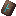

# 更好的盔甲纹饰（Better Armor Trim）

给盔甲纹饰附加真实增益的 **纯服务端** Fabric 模组：服务器装了就生效，客户端（原版 / 整合包 / 基岩端）**不需要装任何东西**。

> ## ⚠️ 代码由 AI 编写
>
> **本模组的代码全部由 AI 编写。** 使用前请自行审查代码，作者不对由此产生的任何问题负责。

- 游戏版本：**Minecraft 1.21.1** · Fabric Loader ≥ 0.16 · 需要 **Fabric API**
- 模组 ID：`betterarmortrim` · 当前版本：0.1.0
- 作者：wandou12581

---

## 核心规则

| 维度 | 作用 |
|---|---|
| **图案**（pattern） | 决定「给什么增益」，18 种纹饰各不相同 |
| **材质**（material） | 决定「多强」，10 种材质压成 4 档 |
| **件数** | 同一图案穿得越多，强度点越高、层级越高 |

**强度点 B** = 四件盔甲材质档之和 `S` 经分段压缩后取整（0–10）：

$$
S = L_1 + L_2 + L_3 + L_4 \qquad (0 \le S \le 16)
$$

$$
B(S) = \begin{cases}
S & 0 \le S \le 4 \\
4 + \frac{3}{4}(S - 4) & 4 < S \le 8 \\
7 + \frac{3}{8}(S - 8) & 8 < S \le 16
\end{cases}
\qquad B = \lfloor B(S) \rfloor
$$

其中 `L1..L4` 是四件盔甲各自的材质档，空槽或没有该纹饰记 0。

| 层级 | 条件 | 对应 S | 典型装备 |
|---|---|---|---|
| L1 | B ≥ 1 | ≥ 1 | 任意一件 |
| L2 | B ≥ 4 | ≥ 4 | 1 件下界合金 / 全套一档 |
| L3 | B ≥ 7 | ≥ 8 | 2 件下界合金 / 全套二档 |
| L4 | B = 10 | = 16 | 全套下界合金（唯一途径） |

材质档：铜 / 石英 / 红石 / 青金石 / 紫水晶 = 1；铁 / 金 / 绿宝石 = 2；钻石 = 3；下界合金 = 4。

---

## 纹饰映射表

> 效果里 `×B` 表示随强度点线性增长；`L2/L3/L4` 是到层后追加或替换。

| 图标 | 纹饰 | 大类 | L1 | L2 | L3 | L4 |
|---|---|---|---|---|---|---|
|  | **海岸盔甲纹饰** | 海洋 | 水下挖掘 0.08×B | 最大生命 +2 | 最大生命 +4 | 海豚的恩惠、抗性提升 II |
|  | **潮汐盔甲纹饰** | 海洋 | 额外氧气 0.1×B | 水中移动 0.1×B | 水中移动 0.15×B | 潮涌能量 |
|  | **涡流盔甲纹饰** | 海洋 | 水中移动 0.1×B | — | 额外氧气 +1 | 摔落减伤 50% |
|  | **沙丘盔甲纹饰** | 荒漠 | 移动速度 2%×B | — | — | — |
|  | **荒野盔甲纹饰** | 荒漠 | 跳跃提升 I | 跳跃提升 II | 跳跃提升 III | 速度 II |
|  | **尖塔盔甲纹饰** | 荒漠 | 击退强度 0.1×B | — | — | — |
|  | **哨兵盔甲纹饰** | 卫戍 | 护甲 0.4×B | 护甲韧性 0.1×B | — | — |
|  | **恼鬼盔甲纹饰** | 卫戍 | 攻击伤害 0.3×B | — | — | — |
|  | **监守盔甲纹饰** | 卫戍 | 抗性提升 I | 抗性提升 II | 伤害吸收 II | 力量 III |
|  | **幽静盔甲纹饰** | 幽域 | 潜行速度 3%×B | — | — | — |
|  | **塑造盔甲纹饰** | 幽域 | 急迫 I | 急迫 II | 急迫 III | 方块交互距离 +2 格 |
|  | **镶铆盔甲纹饰** | 幽域 | 攻击速度 0.1×B | — | 横扫伤害比率 +1.5 | 盔甲韧性 +2 |
|  | **眼眸盔甲纹饰** | 血肉 | 幸运 0.25×B | — | — | 夜视 |
|  | **肋骨盔甲纹饰** | 血肉 | 最大生命 1×B | — | — | — |
|  | **猪鼻盔甲纹饰** | 血肉 | 击退抗性 3%×B | — | — | — |
|  | **向导盔甲纹饰** | 庶民 | 方块交互距离 0.1×B | — | — | 实体交互距离 +2 格 |
|  | **牧民盔甲纹饰** | 庶民 | 生命恢复 I | 生命恢复 II | 最大生命 +4 | 幸运 I、跳跃提升 I |
|  | **雇主盔甲纹饰** | 庶民 | 伤害吸收 I | 伤害吸收 II、蓄风 | 伤害吸收 III、盘丝 | 渗浆、抗性提升 I |

### 材质 → 档位

| 档 | 材质 |
|---|---|
| 1 | 铜  · 石英  · 红石  · 青金石  · 紫水晶  |
| 2 | 铁  · 金  · 绿宝石  |
| 3 | 钻石  |
| 4 | 下界合金  |

---

## 相克

6 个大类分成 **3 对**，同一对的两个大类同时穿会触发相克；**跨对不冲突**，同一大类内部永远安全。

| 相克对 | 大类 A | 大类 B |
|---|---|---|
| 对一 | **海洋**（海岸  / 潮汐  / 涡流 ） | **荒漠**（沙丘  / 荒野  / 尖塔 ） |
| 对二 | **幽域**（幽静  / 塑造  / 镶铆 ） | **血肉**（眼眸  / 肋骨  / 猪鼻 ） |
| 对三 | **卫戍**（哨兵  / 恼鬼  / 监守 ） | **庶民**（向导  / 牧民  / 雇主 ） |

**惩罚只额外挂 debuff，不会抵消纹饰本身的增益。**

| 触发的相克对 | 1 对 | 2 对 |
|---|---|---|
| 对一 海洋⇄荒漠 | 缓慢 I | 挖掘疲劳 II |
| 对二 幽域⇄血肉 | 虚弱 I | 失明 |
| 对三 卫戍⇄庶民 | 饥饿 I | 寄生（infested） |

4 件最多只能同时踩 2 对；触发 2 对时**每个触发的对都升级成重惩罚**。

---

## 命令

| 命令 | 作用 | 权限 |
|---|---|---|
| `/triminfo` | 查看四件纹饰、S/B/层、具体数值（增益绿色、惩罚红色） | 所有玩家 |
| `/batrim reload` | 热重载 `config/betterarmortrim/` | 2 |

也可以直接用 `/execute as <玩家> run triminfo` 从控制台看。

---

## 配置

首次启动生成：

```
config/betterarmortrim/
├── settings.json        全局设置（总开关、tick 间隔、材质档、强度曲线、相克对、常驻显示）
├── README.txt           字段说明
└── trims/
    ├── coast.json       每种纹饰一个文件，各自独立
    ├── tide.json
    └── …（共 18 个）
```

`settings.json` 关键项：

| 字段 | 默认 | 说明 |
|---|---|---|
| `enabled` | `true` | 总开关，`false` 时完全不跑（用于 A/B 测性能） |
| `tickInterval` | `20` | 每多少 tick 重算一次，20 = 1 秒 |
| `knee1` / `knee2` | `4` / `8` | 强度曲线的两个拐点 |
| `knee1Slope` / `knee2Slope` | `0.75` / `0.375` | 分段斜率 |
| `materials` | 10 种材质 | 材质 → 档位 |
| `pairs` | 3 对 | 相克对 + 轻重惩罚 |
| `tab.position` | `footer` | 常驻显示位置：`header` / `footer` / `bossbar` / 空 = 关闭 |
| `tab.prefix` | `纹饰增益：` | 常驻显示前缀 |

单个纹饰文件（例：`trims/dune.json`）：

```json
{
  "trim": "minecraft:dune",
  "enabled": true,
  "category": "荒漠",
  "minPieces": 1,
  "base": {
    "type": "attribute",
    "attribute": "minecraft:generic.movement_speed",
    "operation": "multiply_base",
    "perPoint": 0.02
  },
  "stages": []
}
```

- `base`：属性按 `perPoint × B` 给；`type: "effect"` 时按层数给等级；
- `stages`：`at` 到阈值才追加，`id` 相同的后层覆盖前层（例如海岸的 `max_health` +2 → +4）。

改完执行 `/batrim reload` 即生效，不用重启。

---

## 常驻显示

按 `tab.position` 把当前增益常驻显示在：

- `header` —— tab 列表顶部（推荐，能和 TabTPS 这类只写底部的插件共存）
- `footer` —— tab 列表底部
- `bossbar` —— 屏幕上方 Boss 栏（单行，条会占位）
- 留空 —— 关闭

没有增益时整块不显示，也不会发包。

> `header` 模式用 mixin 拦截出站 tab 包，只改 header、保留 footer，所以不会把 TabTPS 的 tps/mspt 顶掉。

---

## 已知限制

- 纯服务端，只能复用原版效果/属性；不提供自定义 HUD 或物品 tooltip；
- 基岩端（Geyser）看不到别人身上的纹饰，但增益判定正常；
- Boss 栏是单行，4 条增益会较长，可能被客户端截断；
- 数值目前是设计稿起点值，实测后可改 `trims/*.json` 微调。
